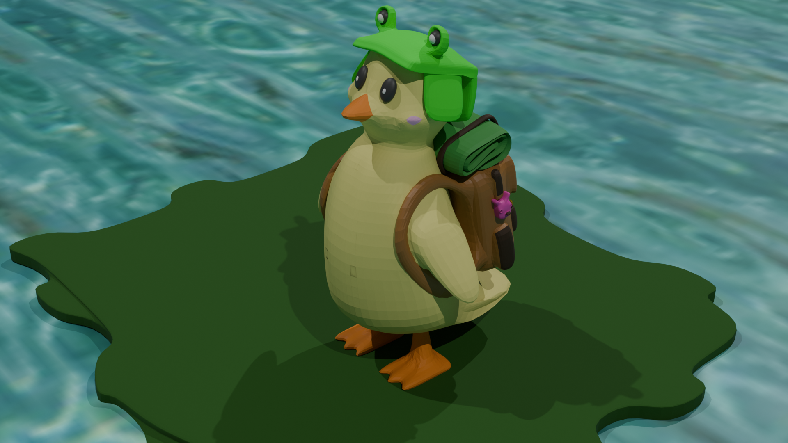
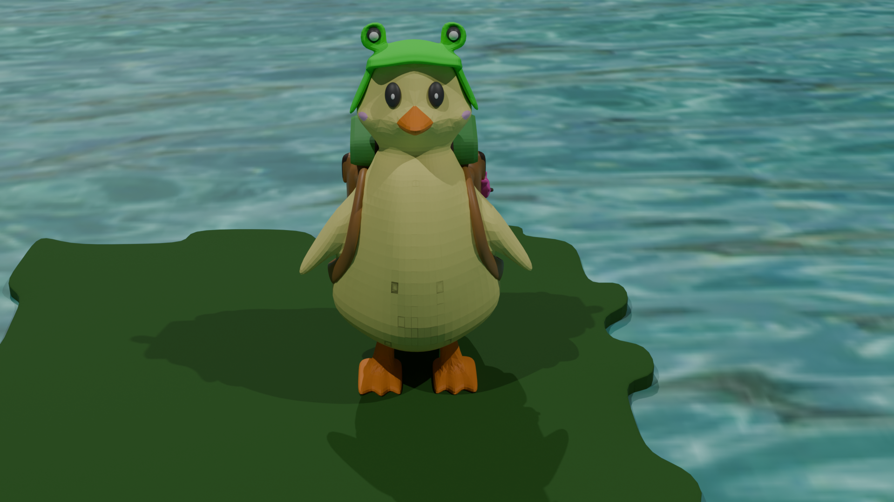
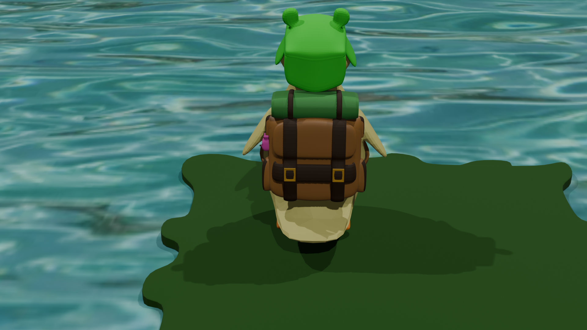
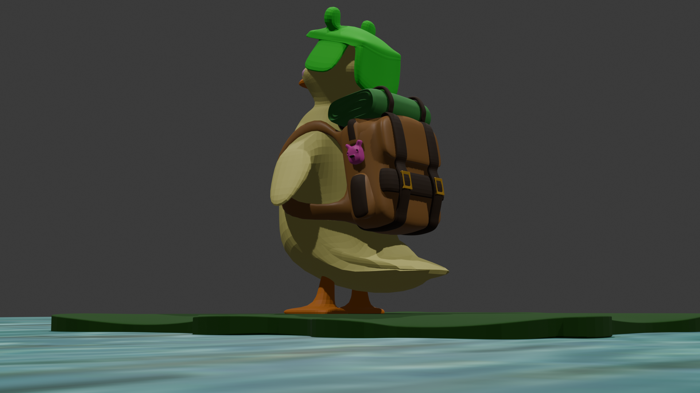

# 🐦 3D Bird Model

A stylized 3D bird model created using Blender, featuring a colorful character and a natural water environment.

## Renders

### View 1

### View 2

### View 3

### View 4

## Project Details

- **Software:** Blender
- **Category:** 3D Character Modeling
- **Project Type:** Stylized 3D modeling
- **File Format:** `.blend`

## Project Files

- `bird.blend` — Original Blender project file.
- `img1.png` — First rendered view.
- `img2.png` — Second rendered view.
- `img3.png` — Third rendered view.
- `img4.png` — Fourth rendered view.

## How to Open

Download `bird.blend` and open it in Blender to explore the model.

## Tools Used

- Blender
- GitHub
- VS Code